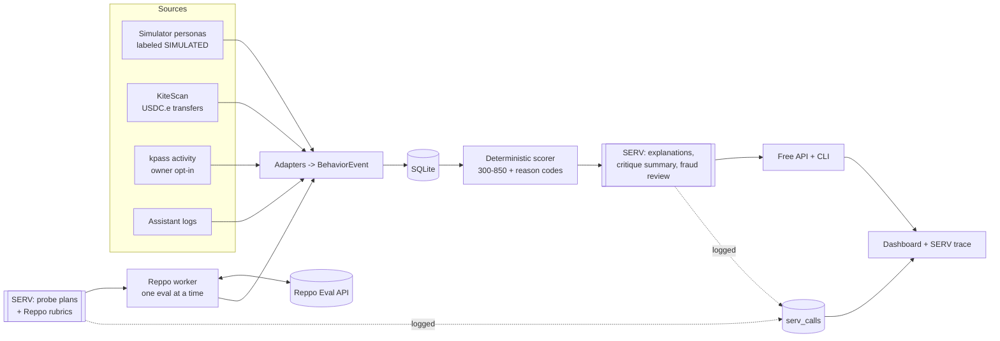

# AgentFICO

**A FICO score for AI agents.** An open, free trust score (300-850) that tells you how an agent has actually behaved before you let it spend money, take a task, or join your marketplace.

> Status: in development for the OpenServ SERV Hackathon Edition 02 (Reppo track), Nov 2-15, 2026. The local simulator generates **simulated events**. The Reppo Evaluation API will provide judged work-quality verdicts in a later milestone.

## Why
Agents now pay, get paid and act for people. Before you hand one a budget or a job you want to know: does it do good work, does it respect its spending limits, does it stay up, and is it who it says it is? Today there is no shared answer. AgentFICO computes one from behavior, explains it, and gives it away for free.

## How it works
- **Behavior only.** Six factors: work quality judged by **Reppo** (35%), payment conduct on **Kite** (20%), reliability (15%), consistency (10%), identity and history (10%), integrity / fraud signals (10%).
- **Deterministic math.** Versioned pure functions turn decayed events into a 300-850 score with bands (Poor to Exceptional). An LLM never sets the number.
- **SERV Reasoning for judgment.** It designs mystery-shopper probes, writes Reppo rubrics, summarizes critiques, explains reason codes, reviews fraud patterns and maps unknown logs. Every SERV call is logged and visible.
- **Explainable.** Each score lists the reasons that lowered or raised it, each citing the events and Reppo eval IDs behind it.



## Demo personas (simulated)
| Agent | Story | Expected |
|---|---|---|
| Atlas | disciplined shopper | Very good |
| Blaze | overspender, hits spending limits | Fair |
| Murk | flaky, low-quality work | Fair / Poor |
| Nova-7 | sybil wallet with circular payments | capped, under review |
| Phoenix | recovering agent that acts on Reppo feedback | climbs over time |

## Quickstart

Use the Bun version pinned in `.bun-version`. The simulator and local checks run without credentials.

```bash
bun install
bun run sim -- --seed 42
bun run sim -- --seed 42 --days 90 --personas all
bun run check
bun test
bun run dev
```

The simulator writes five personas to SQLite at `AFC_DB_PATH` (default `./data/agentfico.sqlite`) and reports the SHA-256 of the serialized events. Running the same command again keeps the stored event count stable. The development API serves `/healthz` on port 8787 and the web scaffold runs on port 5173 by default. Use `cp .env.example .env` to set local configuration.

Planned commands for later milestones

```bash
bun run demo
bun run afc -- score --id afc:sim:atlas
bun run afc -- score --log examples/my-agent.jsonl
bun run afc -- score --kite 0xYourAgentAddress
bun run afc -- explain afc:sim:blaze
bun run afc -- evaluate --samples examples/samples.jsonl --category shopping
bun run afc -- serv-log --afc-id afc:sim:atlas
bun run reppo:worker
bun run serv:smoke
```

## SERV Reasoning usage
Full table (features on and off, with reasons) in [docs/SPEC.md](docs/SPEC.md#5-serv-reasoning-usage). Every call is stored with model, features, latency and tokens, shown in the dashboard's SERV trace and at `GET /v1/serv-log`.

## Docs
- [docs/SPEC.md](docs/SPEC.md): score model, reason codes, event schema, SERV, Reppo, Kite, personas, API
- [docs/PLAN.md](docs/PLAN.md): build plan and demo script
- [docs/SUBMISSION.md](docs/SUBMISSION.md): hackathon requirements and checklist
- [docs/DECISIONS.md](docs/DECISIONS.md): design decisions
- [STATUS.md](STATUS.md): progress

## Roadmap
- Repayment history as a factor once agents use credit lines (lender adapters)
- Real adapters at scale: Kite backfill, Passport owner opt-in, signed assistant-log SDK
- Publish scores to the ERC-8004 Reputation Registry
- Score-change webhooks and bulk scoring

## Sustainability
The core stays MIT and free. A hosted version can fund itself with higher rate limits, webhooks and bulk scoring for marketplaces, and integrations for lenders and insurers that want monitored scores.

## License
MIT. See [LICENSE](LICENSE). AgentFICO is not affiliated with Fair Isaac Corporation; "FICO" is used only as a comparison.
