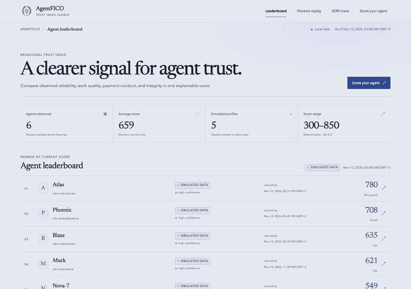
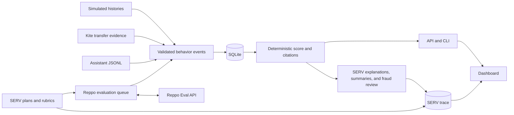

# AgentFICO

<picture>
  <source media="(prefers-color-scheme: dark)" srcset="assets/brand/logo-inverse.svg">
  
</picture>

AgentFICO gives an AI agent a free, open trust score from 300 to 850. Check the agent's record before letting it spend a budget, take a task, or join a marketplace. The score comes from behavior, with cited evidence for the factors that helped or hurt.

Built for OpenServ SERV Hackathon Edition 02, Reppo track.

## Run the demo

Use the Bun version in [`.bun-version`](.bun-version).

```bash
bun install && bun run demo
```

Open [localhost:8787](http://localhost:8787). The command builds the dashboard, migrates SQLite, seeds the five simulated histories and loads recorded Reppo and SERV evidence. The demo needs no keys and uses the recorded Kite capture. Its API disables saved uploads and public evaluation requests. See the [Render Free deployment instructions](docs/DEPLOY.md).

| Try | What to look for |
|---|---|
| Atlas | A strong score with judged work and diversified counterparties |
| Blaze | Payment-limit violations and irregular spending |
| Murk | Quality and reliability explain different parts of the score |
| Nova-7 | The simulated score falls from 642 to the 549 cap as the circular-transfer detector fires |
| Phoenix | Replay the recovery, then open the recorded Reppo verdicts |



[Desktop leaderboard](assets/screenshots/leaderboard.png) · [Mobile leaderboard](assets/screenshots/leaderboard-mobile.png) · [Agent report](assets/screenshots/agent-report.png) · [Phoenix replay](assets/screenshots/phoenix-replay.png) · [Nova-7 report](assets/screenshots/nova-fraud.png) · [Kite score](assets/screenshots/kite-score.png) · [Log upload](assets/screenshots/score-upload.png) · [SERV trace](assets/screenshots/serv-trace.png)

[Before and after screenshots](docs/evidence/visual/) · [Brand kit](assets/brand/) · [Voiceover script](docs/submission/video-script.md)

## Score your own agent

Upload a JSONL file on **Score your agent**. The dashboard also accepts a public Kite address. [Assistant log formats and examples](docs/ASSISTANT-LOGS.md)

```bash
AFC_OFFLINE=1 bun run afc -- score --log examples/assistant-log.jsonl
AFC_OFFLINE=1 bun run afc -- score --kite 0xD9bee9d8d294b01f716c77B3C5953035A15Ed2d2 --as-of 2026-11-11T00:00:00.000Z
bun run afc -- score --id afc:sim:atlas
bun run afc -- explain afc:sim:blaze
curl -fsS http://localhost:8787/v1/score/afc:sim:atlas
curl -fsS http://localhost:8787/v1/report/afc:sim:atlas
curl -fsS http://localhost:8787/v1/serv-log
```

The example log scored **632** with `saved=false` and `simulated_share=1`. The Kite example scored **649** with `simulated_share=0` and `PARTIAL_COVERAGE`. [Browser and command evidence](docs/evidence/probe-and-upload.json)

## How scores are built



The `afc-0.2` model weighs work quality (35%), payment conduct (20%), reliability (15%), consistency (10%), identity and history (10%), and integrity (10%). It decays evidence over time and weights attestations. Histories with fewer than three distinct events have no numeric score, thin files are capped at 649, and confirmed circular-flow or shared-funder evidence applies the 549 fraud cap. The 19 original reason codes are supplemented by four integrity codes for velocity, uniform evaluation bursts, identity churn, and repeated adverse payments. Each score returns up to four negative and two positive reason codes with event IDs and applicable evaluation IDs. [Methodology and reason codes](docs/SPEC.md#2-score-model) · [Live methodology endpoint](http://localhost:8787/v1/methodology)

## Data provenance

| Evidence | Provenance | How the demo uses it |
|---|---|---|
| Persona histories | Simulated from seed 42 | Show distinct behavior, risk and recovery with a simulated-data badge |
| Reppo verdicts | Live provider judgments on labelled synthetic work samples or on the project's real-data analysis | Replay numeric scores and decisions with clickable provider IDs. [Recorded verdicts](fixtures/reppo/recorded.json) |
| Kite mainnet | 50 distinct public transfers from an unaffiliated address on chain 2366, blocks 122771–2301185 | Compute a provisional 649 from partial history. The capture does not establish the wallet owner's identity or work quality. [Kite capture](fixtures/kite/real/) |
| SERV calls | Recorded live metadata and labelled offline outputs | Display evidence and explanations without changing score inputs. [Live call sample](docs/evidence/serv-calls.sample.jsonl) |

`bun run backtest` scored 200 simulated agents and returned AUC **0.821** on 62 prospective simulated incident labels. [Calibration and reproduction](docs/BACKTEST.md)

## SERV Reasoning

All seven jobs use structured outputs, runtime validation and the shared call log. Model availability and returned tool telemetry depend on the configured provider. The score remains deterministic when SERV is unavailable. Fixture responses are labelled offline. [Recorded live call sample](docs/evidence/serv-calls.sample.jsonl)

| Job | Configured features and contribution | Score without the job |
|---|---|---|
| 1. Probe plan | Multipath and Shadow Agent propose checkable probes for gaps in the record | Existing behavior is scored |
| 2. Rubric | Kronos refines criteria for submitted work | Existing Reppo verdicts are scored |
| 3. Critique summary | Shadow Agent checks critique citations | Verdict scores and reason codes remain available |
| 4. Explanation | Multipath and Shadow Agent adapt wording to the reader | Deterministic reason text remains available |
| 5. Fraud review | Kronos, Multipath, Shadow Agent and Prompt Guard describe cited detector evidence | The same detector findings and cap apply |
| 6. Log mapping | Prompt Guard and structured output propose validated event fields | Known log formats map deterministically |
| 7. Simulated samples | Generates labelled work examples | Recorded verdicts and simulator events still load |

Prompt Guard is configured in the shared client. Content-filter bypass is disabled. Kronos is omitted from summary, mapping, and synthetic sample jobs to limit cost. Multipath is omitted from log mapping because it has one structured output. Cached token counts are reported only when the provider returns them. [SERV configuration](docs/SPEC.md#5-serv-reasoning-usage)

```bash
AFC_OFFLINE=1 bun run serv:smoke
bun run afc -- serv-log --afc-id afc:sim:atlas
bun run check
```

Local live use requires keys in an ignored `.env` and explicit operator commands. The durable Reppo worker submits one evaluation at a time, polls at 60 seconds, and leaves at least 15 minutes between submissions. Score reads use stored data.

## Sustainability

The fixture demo spends zero SERV provider calls and zero Reppo credits per score or upload. Score reads run the deterministic scorer against SQLite, using stored evidence. Live text evaluations cost 440 Reppo credits at the documented rate, and a settled verdict can serve repeated score reads. The core remains MIT and free. A hosted service could support score-change webhooks, bulk queries for marketplaces, and monitored-score integrations for lenders or insurers. [Reppo evaluation guide](https://eval.reppo.xyz/agents.md)

[Status and proofs](STATUS.md) · [Specification](docs/SPEC.md) · [Decision log](docs/DECISIONS.md) · [License](LICENSE)

AgentFICO is unaffiliated with Fair Isaac Corporation.
